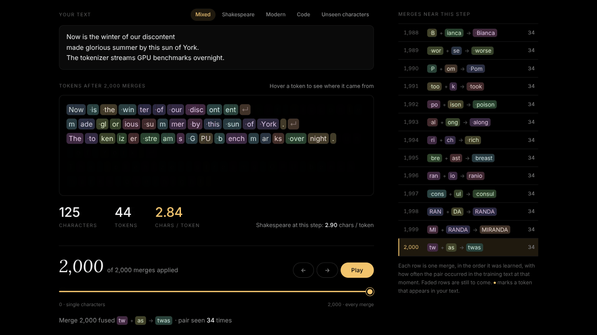

# How a model reads

[](loop/how-a-model-reads-loop.mp4)

<sub>10-second loop. Click for the MP4 (1280×720, 1.0 MB); the GIF above is 1280×720, 1.5 MB.</sub>

A byte-pair encoding (BPE) tokenizer, the kind GPT-style models use, learned from scratch in plain Python on tiny-shakespeare. The page shows it merge by merge.

Type or paste text, or pick an example, and it is split into tokens drawn as coloured pills, one colour per token id. The slider runs from 0 merges (single characters) to all 2,000. As you scrub, neighbouring pills slide together and take the new token's colour. A readout gives characters, tokens and characters per token for your text, next to the same ratio for the training text at that step; a side list shows the merges around the current step, and a small curve shows how much the training text compresses.

## Open it

**Live:** [joezgao.github.io/how-a-model-reads/how-a-model-reads.html](https://joezgao.github.io/how-a-model-reads/how-a-model-reads.html) (nothing to install).

Open `how-a-model-reads.html` in a recent browser. It is a single 75 kB file with the merge list inlined; it loads two fonts from Google Fonts.

- **Examples**: Mixed, Shakespeare, Modern, Code and Unseen characters.
- **Slider**, <kbd>←</kbd> <kbd>→</kbd> and **Play**: step through the merges. With the token row focused, the arrow keys step through the tokens one at a time.
- Hover a token to see where it came from.
- **How it works** (the link under the stats card jumps there) and **What BPE does not do** sit below the tokens. On a phone the slider comes straight after the text box, above the tokens it changes.

## Method

- **Character-level, not byte-level.** The base vocabulary is the 65 distinct characters in tiny-shakespeare (pure ASCII, so on the training text characters and bytes are the same). A character never seen in training (é, 🙂, 東) becomes its own token with id −1, is never merged, and is drawn with an outline.
- **Pre-split (GPT-2 style, simplified).** Before counting, one regex cuts the text into chunks: a word with its leading space, a digit run, a punctuation run, or whitespace. Merges never cross a chunk edge. Explicit ASCII classes are used instead of `\s` / `\w`, so Python's `re` and JavaScript's `RegExp` split identically:
  ```
   ?[A-Za-z]+| ?[0-9]+| ?[^ \t\n\rA-Za-z0-9]+|[ \t\n\r]+(?![^ \t\n\r])|[ \t\n\r]+
  ```
- **Training** (`train.py`). Count adjacent pairs over the 15,056 distinct chunks, weighted by frequency, and fuse the most frequent pair everywhere, left to right without overlap. Ties go to the smallest `(left id, right id)`. Pair counts are updated incrementally. 2,000 merges take about 3 s.
- **Encoding.** For each chunk, start from characters and keep applying the earliest-learned merge among the first *k* that fits. This is the GPT-2 rule, and it reproduces the training-time segmentation. The slider sets *k*.
- **Check.** On 3,444 cases (287 strings at 12 merge steps: training lines, multi-line windows, and edge cases such as CRLF, tabs, code, emoji, CJK, Arabic and NBSP), the page's JavaScript encoder matched the Python trainer's token ids exactly in every case. `train.py` also asserts that re-encoding the whole training text with all merges gives the logged final count.

## Numbers

| | |
|---|---|
| Training text | 1,115,394 characters, 65 distinct |
| Distinct pre-split chunks | 15,056 |
| Merges / vocabulary | 2,000 / 2,065 |
| Merge 1 | `·` + `t` → `·t`, pair count 23,837 |
| Merge 12 | `·t` + `he` → `·the`, 8,684 |
| Merge 2,000 | `tw` + `as` → `twas`, 34 |
| Longest token | `NORTHUMBERLAND` (14 characters), merge 1,482 |
| Characters per token, training text | 1.02 after 1 merge · 1.62 after 100 · 2.21 after 500 · 2.54 after 1,000 · 2.90 after 2,000 |
| Training text in tokens, at the end | 384,882 |

`·` stands for a space.

## What is standard and what is not

Standard: the BPE merge loop of Sennrich et al. on top of Gage's pair-replacement idea, GPT-2-style pre-splitting with the leading space attached to words, and earliest-merge-first encoding.

Not standard: a character-level base vocabulary instead of 256 bytes (so unseen characters exist); no contraction rules in the regex (`'twas` → `'` + `twas`); only ASCII whitespace counts as whitespace; no special tokens and no normalisation; and 2,000 merges on one author, tiny next to production tokenizers.

## Limits

- The vocabulary is shaped by the play-script format. Speaker names in capitals (`NORTHUMBERLAND`, `MIRANDA`) take merges that modern text never uses, and modern words fall apart (`smartphone` → `s m art p h one`).
- Counts in the side list are pair frequencies at the moment of merging, counted the standard naive way; for overlapping runs like `aaa` a count can slightly exceed the merges actually made. The training-text totals use the actual merges.
- The page draws at most 3,000 characters of pills (all text is still counted), and input is capped at 6,000 characters.

## Train it yourself

```bash
curl -O https://raw.githubusercontent.com/karpathy/char-rnn/master/data/tinyshakespeare/input.txt
python3 -I train.py input.txt 2000     # writes train.log and model.json next to train.py
```

The text used here has md5 `6fb458f1232090904fb40fe944165e91`.

`train.log` has one line per merge (step, left, right, new token, id, pair count, training-text tokens after). The script that inlines `model.json` into the page, and the test cases, are not included in this repository.

## In this repository

- `how-a-model-reads.html`: the piece
- `train.py`: the trainer and reference encoder
- `screenshots/`: the desktop view and the phone layout
- `loop/`: the loop video, its GIF and a poster

## Credits and license

- Rico Sennrich, Barry Haddow and Alexandra Birch. *Neural Machine Translation of Rare Words with Subword Units.* ACL 2016. [arXiv:1508.07909](https://arxiv.org/abs/1508.07909).
- Alec Radford, Jeffrey Wu, Rewon Child, David Luan, Dario Amodei and Ilya Sutskever. *Language Models are Unsupervised Multitask Learners.* OpenAI, 2019 (GPT-2, for the pre-split rule and byte-level BPE).
- Philip Gage. *A New Algorithm for Data Compression.* C Users Journal 12(2), 1994.
- Training text: tiny-shakespeare from Andrej Karpathy's [char-rnn](https://github.com/karpathy/char-rnn).

Code: MIT. See [LICENSE](LICENSE). The fonts are under the SIL Open Font License.

Built with Claude for Joe Gao.
